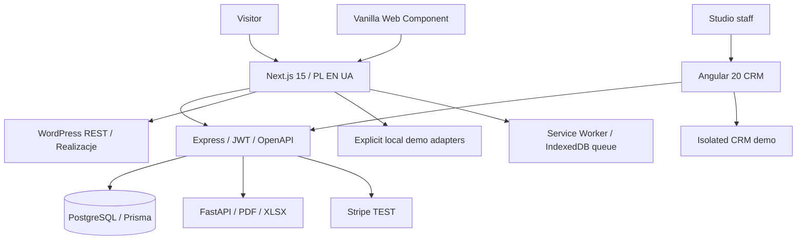

# APEX Studio

**Concept / demo project · full-stack portfolio · Andrii Tsap**


A coherent automotive studio platform: configure a GT-class coupé, calculate a service estimate, make a demo booking, review the customer account and manage operations in an Angular CRM. All illustrative content is explicitly marked. No real clients, reviews, automotive brand affiliation or actual services are claimed.

**Live demo:** https://andriu-tsap.github.io/apex-studio/ · **CRM (demo, no password):** https://andriu-tsap.github.io/apex-studio/crm/ · GitHub Pages hosts the static export; the backend services run locally via Docker Compose. Checks and limits are recorded in [VALIDATION.md](docs/VALIDATION.md).

## GitHub Pages build

```sh
NEXT_PUBLIC_BASE_PATH=/apex-studio NEXT_PUBLIC_ADMIN_URL=/apex-studio/crm/ pnpm --filter @apex/web... build
cd apps/admin && npx ng build --base-href /apex-studio/crm/
```

## Швидкий перегляд без встановлення залежностей

Потрібен **Node.js 22.18+**. Із кореня розпакованого проєкту:

```sh
node scripts/preview.mjs
```

Відкрити **http://localhost:3000/en/** або `/pl/`, `/ua/`. Це готова production-збірка з папки `preview/`.

Для готової Angular CRM у другому терміналі:

```sh
node scripts/admin-preview.mjs
```

Відкрити **http://localhost:4200** → «Wejdź jako demo-admin». Пароль не потрібен. Це ізольована демонстраційна роль, яка не надає прав на API.

Демо підтримує налаштування авто, PNG, бронювання, прев’ю листа, PDF, кошик, неоплачуване демозамовлення, кабінет, CRM, Excel, блог, FAQ та офлайн-чергу. Дані демо зберігаються у вашому браузері. Вводьте вигадані дані.

## Повний стек: одна команда

Потрібні Docker Engine/Desktop і Compose v2:

```sh
docker compose up --build
```

| Сервіс                | Адреса                     |
| --------------------- | -------------------------- |
| Next.js frontend      | http://localhost:3000      |
| Angular CRM           | http://localhost:4200      |
| Express API / Swagger | http://localhost:4000/docs |
| FastAPI / Swagger     | http://localhost:8001/docs |
| WordPress             | http://localhost:8080      |
| PostgreSQL            | localhost:5432             |

Compose запускає web, admin, api, py-service, PostgreSQL, WordPress, його MariaDB та одноразове налаштування CMS. API застосовує міграції та ідемпотентні сиди. Перший запуск потребує інтернету для образів і пакетів; WordPress ініціалізується окремим `wp-setup` сервісом. Для повного стеку варто виділити Docker достатньо диска та пам’яті.

Усі опубліковані порти прив’язані до `127.0.0.1`. Значення за замовчуванням — **для локального демо**. Перед зовнішнім розгортанням замініть облікові дані, CORS origins, service token, URL та увімкніть HTTPS і `COOKIE_SECURE=true`. Проксі/довірений CA середовища не включено до архіву; Dockerfile підтримує необов’язковий BuildKit secret `proxy_ca` зі збереженням перевірки TLS.

### Облікові записи API після seed

| Email             | Пароль        | Роль     |
| ----------------- | ------------- | -------- |
| admin@apex.demo   | ApexDemo2026! | admin    |
| manager@apex.demo | ApexDemo2026! | manager  |
| client@apex.demo  | ApexDemo2026! | customer |

WordPress: `apex-demo` / `ApexDemo2026!` (локальна демонстрація; змінюється через `.env`). Паролі в PostgreSQL хешуються bcrypt. Access JWT живе 15 хвилин у пам’яті; refresh cookie — HttpOnly із ротацією та хешованим токеном у БД.

## Розробка

```sh
npm install --global pnpm@10.30.3
pnpm install --frozen-lockfile
pnpm db:generate
pnpm dev
```

Скопіюйте `.env.example` у потрібні локальні `.env` файли: `apps/web/.env.local` для Next.js та `apps/api/.env` для Prisma CLI. API-команди й Prisma читають `apps/api/.env`; Docker Compose передає змінні автоматично.

В окремих терміналах:

```sh
pnpm dev:api
pnpm dev:admin
```

Python:

```sh
python -m venv .venv
# Activate the virtual environment using your OS shell.
pip install -r apps/py-service/requirements.txt
cd apps/py-service
uvicorn main:app --port 8001
```

Запуск БД без решти стеку: `docker compose up -d postgres`. Потім `pnpm db:migrate` та `pnpm db:seed` зі встановленим `DATABASE_URL`.

## Функції та межі режимів

- **Конфігуратор:** кузов, диски, супорти, тонування, Street/Track/Stealth, деталі-хотспоти, обертання, PNG та перенесення вибору у бронювання. На мобільних/слабких пристроях спочатку статичний SVG; кнопка `3D` вмикає спрощену сцену. Автоматичний рух поважає reduced motion.
- **Бронювання:** React Hook Form + Zod, версійований калькулятор, доступні слоти, явне підтвердження й прев’ю листа. Справжні листи не надсилаються за вимогою демобрифу.
- **API:** перевіряє власника, ціну та дату; унікальний індекс захищає активний слот; UUID-ключ ідемпотентності захищає повторне надсилання. Час студії — Europe/Warsaw з урахуванням DST.
- **Кабінет:** демобронювання/замовлення або історія авторизованого клієнта API, статуси та PDF. Демо й серверні записи мають видимі позначки.
- **Магазин:** локальний кошик, пошук, категорії, кількість, демозамовлення без списання коштів. Stripe test — окрема дія з серверною ціною та перевіреним webhook.
- **CRM:** демовхід або серверна авторизація, календар drag & drop та доступні альтернативні поля дати/часу, таблиця клієнтів із сортуванням, фільтром і пагінацією, admin/manager, графік, SQL-звіт та `.xlsx`.
- **Python:** розрахунок, Unicode PDF, Excel, парсер контрольованого HTML-джерела `/prices`. Парсер не обходить сторонні сайти й не приймає довільні URL.
- **CMS:** WP REST API + `apex_realizacja`; метаполя service/vehicle/finish/demo, nonce та перевірка прав у редакторі. Якщо CMS недоступна — локальні демонстраційні матеріали.
- **PWA:** precache статичних ресурсів, IndexedDB-черга, синхронізація при поверненні мережі. Серверні заявки відправляються лише після перевірки сесії власника; конфлікт не стає фальшивим підтвердженням.
- **FAQ:** правила без зовнішнього AI-ключа, відповіді трьома мовами та пропозиція доступного слота.
- **Навігація:** Ctrl/Cmd + K, клавіатура, локальні шрифти, теми, мобільна верстка, Open Graph, sitemap, structured data з позначенням концепції.

### Stripe test

У `.env` установіть **лише** `STRIPE_SECRET_KEY=sk_test_…` та `STRIPE_WEBHOOK_SECRET`. Перезапустіть API. Для локального Stripe CLI:

```sh
stripe listen --forward-to localhost:4000/webhooks/stripe
```

Авторизуйте клієнта, додайте товар і натисніть Stripe test. У Stripe використайте тестову картку `4242 4242 4242 4242`, майбутню дату та тестовий CVC. Замовлення стає `paid` тільки після підписаного test webhook. Live-ключі й live-події не приймаються. Без ключів залишається окрема дія «демозамовлення».

## 3D-модель та авторство

У цьому пакеті **не використано ненадану користувачем Blender-модель**. Є оригінальна процедурна демомодель `apps/web/public/models/gt-class-demo.glb` (~236 KB) і відтворюваний генератор `scripts/export-model.mjs`. Вона не містить автомобільного логотипу та не видається за модель користувача.

Для власного GLB встановіть `NEXT_PUBLIC_CAR_MODEL` перед збіркою. Компонент `AssetCar` зіставляє матеріали за префіксами мешів `body_`, `wheel_`, `caliper_`, `glass_`. Підготуйте модель у тих самих осях і масштабі; можна адаптувати мапу у `apps/web/src/components/car-scene.tsx`. Демофайл уже значно менший за 5 MB; Draco для нього не потрібний.

Відтворення демофайла: `node --experimental-strip-types scripts/export-model.mjs` після встановлення залежностей.

## Віджет без фреймворку

```html
<apex-booking-widget locale="pl" site-url="https://your-apex-site.example"></apex-booking-widget>
<script type="module" src="https://your-apex-site.example/widget.js"></script>
```

Віджет працює в Shadow DOM. Він переносить послугу та дату в повну форму; самостійно не підтверджує бронювання. Подію `apex-booking-request` можна перехопити через `preventDefault()` для власної інтеграції. HTTPS обов’язковий, окрім localhost. Приклад — `apps/widget/index.html`.

## Архітектура



| Технологія                                                 | Де                              | Навіщо                                          |
| ---------------------------------------------------------- | ------------------------------- | ----------------------------------------------- |
| Next.js, React, TypeScript strict                          | apps/web                        | Публічна платформа, статичний експорт           |
| React Three Fiber, drei, Three.js                          | car-scene.tsx                   | GLB, матеріали, камера, відображення            |
| Framer Motion, Tailwind, CSS-токени                        | apps/web, packages/ui           | Інтерфейс, адаптивність, теми                   |
| next-intl                                                  | apps/web/src/i18n               | PL / EN / UA                                    |
| React Hook Form, Zod                                       | Бронювання, packages/types      | Валідація й спільні контракти                   |
| Angular 20, signals, Material, CDK                         | apps/admin                      | Робочий інтерфейс студії                        |
| Node.js, Express, Prisma                                   | apps/api                        | Авторизація, транзакції, права, оплата          |
| PostgreSQL                                                 | Prisma migration / report query | Дані, індекси, JOIN, агрегати, window functions |
| Python, FastAPI, reportlab, openpyxl, BeautifulSoup        | apps/py-service                 | Ціни, документи, контрольований парсер          |
| WordPress, PHP                                             | apps/wp-plugin                  | Headless-контент і власний плагін               |
| HTML, CSS, Vanilla JS                                      | apps/widget                     | Вбудовуваний компонент                          |
| Service Worker, idb, localStorage                          | apps/web                        | Офлайн-ресурси, черга й налаштування            |
| Docker Compose, GitHub Actions, Vitest, Playwright, pytest | Корінь і модулі                 | Збірка та перевірки                             |

## Перевірки

```sh
pnpm format:check
pnpm lint
pnpm typecheck
pnpm test
pnpm build
pnpm preview:prepare
pnpm test:e2e
python -m pytest apps/py-service -q
```

Для Playwright потрібен Chromium: `pnpm exec playwright install chromium` або шлях `CHROMIUM_PATH` до встановленого браузера. API-інтеграційні тести запускаються, коли задано `DATABASE_URL` до **тестової**, мігрованої БД. Вони створюють і прибирають власні записи. На CI БД і Python запускаються до цих тестів.

Фактичні Lighthouse-результати, браузерні перевірки та відомі межі: [docs/VALIDATION.md](docs/VALIDATION.md). Не підміняємо відсутній зовнішній Stripe/CMS-деплой вигаданою перевіркою.

## Розгортання

`vercel.json` налаштовано на статичний експорт `apps/web/out`. Імпортуйте репозиторій з коренем монорепо як Root Directory. Перед збіркою задайте `NEXT_PUBLIC_SITE_URL`, за потреби API/Admin/WordPress URL. Angular публікується окремо з `apps/admin/dist/browser`; `config.json` задає API URL. Ресурси PWA потребують HTTPS (localhost дозволений).

Серверний стек можна розгорнути з Compose за HTTPS reverse proxy. Рекомендовано API на тому самому site/domain, щоб HttpOnly cookie могла працювати із SameSite=Lax. Статичне демо працює і без серверних сервісів. Папки `preview/` та `preview-admin/` — зафіксовані збірки на момент створення архіву; оновлюються через `pnpm preview:prepare` після нової збірки.

## Що можна зробити для вашого бізнесу

Сайт послуг і брендова презентація, інтерактивний каталог продуктів, онлайн-запис, клієнтський кабінет, магазин із тестованою платіжною інтеграцією, CRM, документи й звіти, CMS та вбудовуваний віджет.

## Історія Git

У ZIP є `source-history.bundle` з локальною історією Conventional Commits. Для відновлення репозиторію: `git clone source-history.bundle apex-studio-source`. У клоні спершу встановіть залежності й зберіть застосунки; готові preview-папки додаються саме до ZIP.

## Ліцензії

Власний код, SVG та процедурна демогеометрія — MIT. Inter, Space Grotesk та DejaVu мають відкриті ліцензії; тексти в `licenses/`. Залежності зберігають власні ліцензії. Фото реальних людей, сторонні шаблони й автомобільні логотипи не використано.
